# ChronoPulse Active (EMOM Timer)

A multi-platform interval timer, biometric telemetry cockpit, and workout analytics suite built with Flutter for **macOS**, **iOS**, **watchOS**, and **Android**.

Designed to run offline-first on local SQLite with bidirectional Firebase Cloud Firestore sync, **ChronoPulse Active** pairs a responsive desktop/mobile training HUD with Bluetooth Low Energy (BLE) heart rate auto-regulation, activity-aware looping Focus Music, Kingsmith WalkingPad treadmill automation, Apple Watch & Apple Health integration, and post-workout Heart Rate Recovery (HRR) analytics.

---

## Screenshots

### macOS Desktop Cockpit

<table>
  <tr>
    <td align="center"><b>Active Workout Cockpit</b><br/>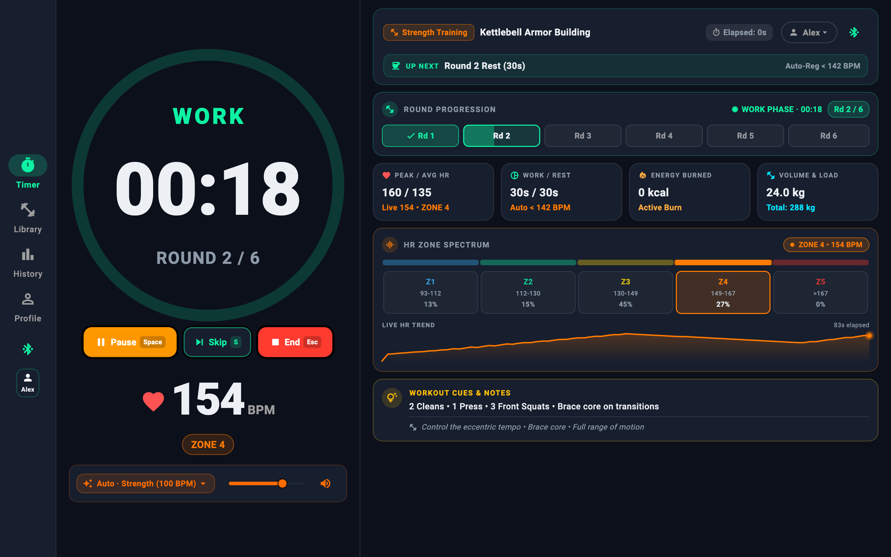</td>
    <td align="center"><b>Pre-Workout Setup & Audio Strip</b><br/>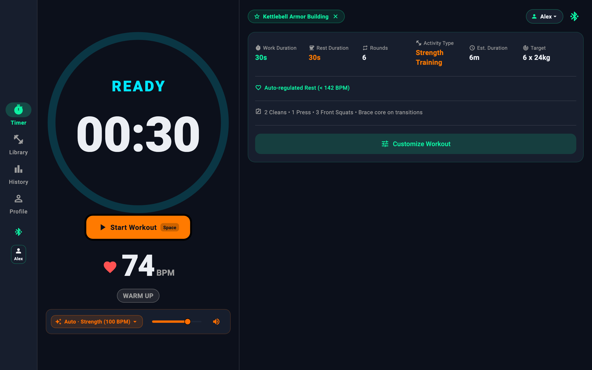</td>
  </tr>
  <tr>
    <td align="center"><b>Workout Library</b><br/>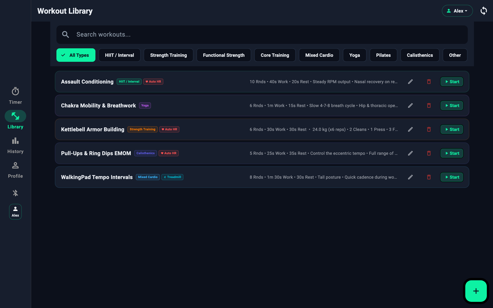</td>
    <td align="center"><b>7-Day Weekly History & Bar Chart</b><br/>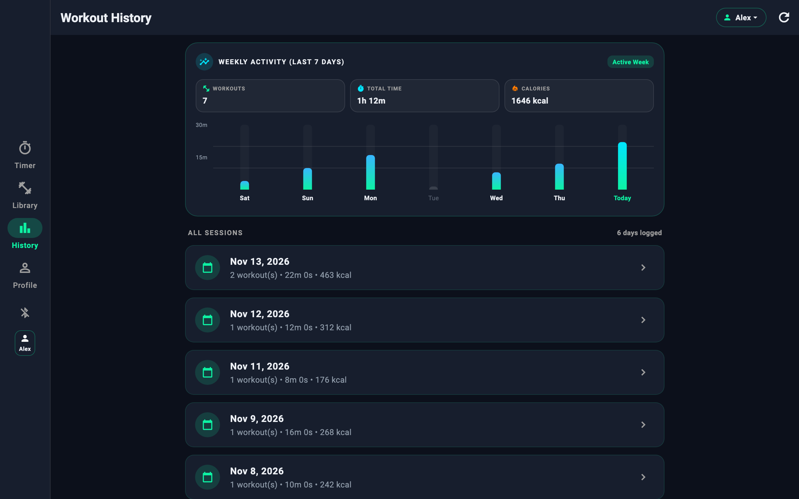</td>
  </tr>
  <tr>
    <td align="center"><b>Daily Details, Table & HR Recovery Chart</b><br/>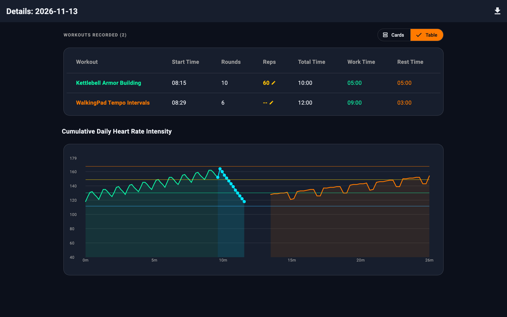</td>
    <td align="center"><b>Biometric Profile & Preferences</b><br/>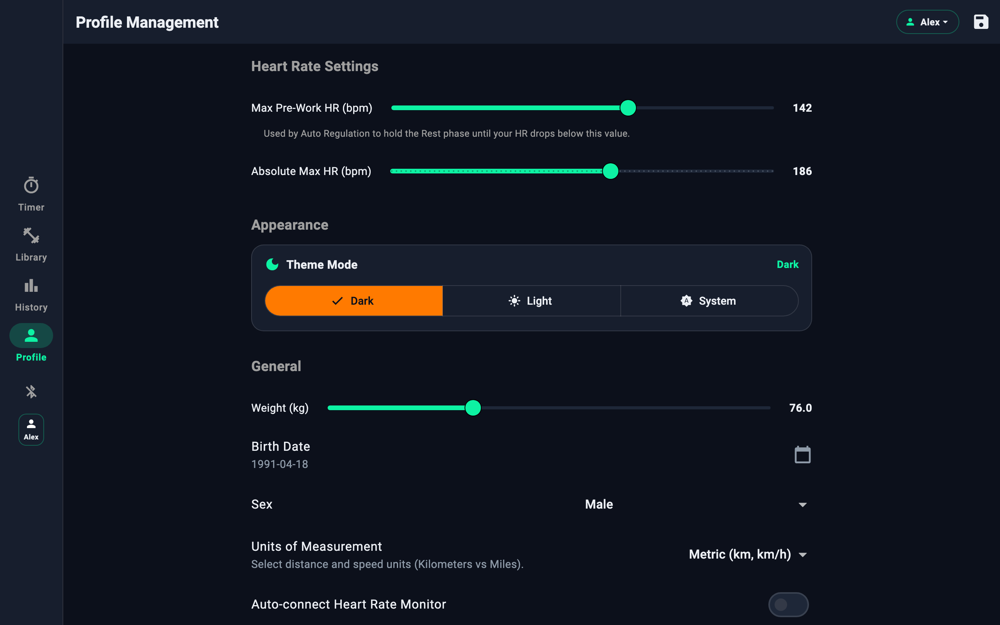</td>
  </tr>
</table>

### iPhone Mobile Experience

<table>
  <tr>
    <td align="center"><b>Timer & Configuration</b><br/>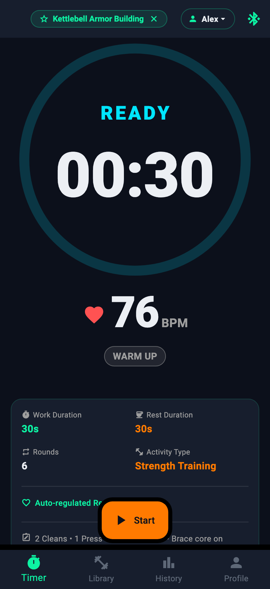</td>
    <td align="center"><b>Active Workout HUD</b><br/>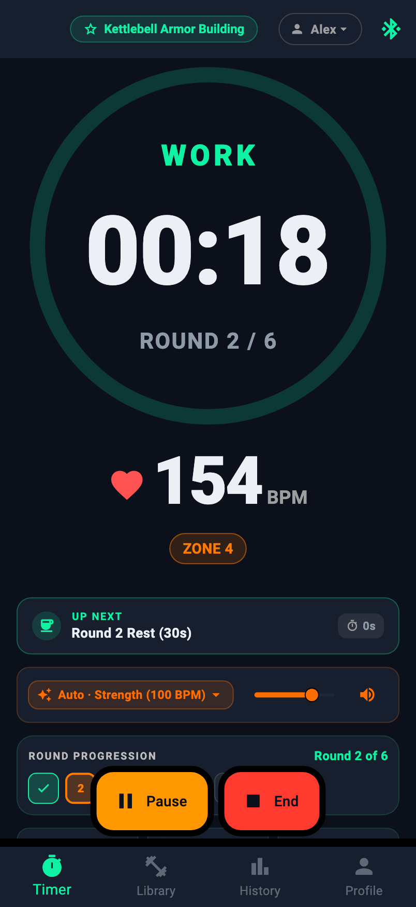</td>
    <td align="center"><b>Workout Library</b><br/>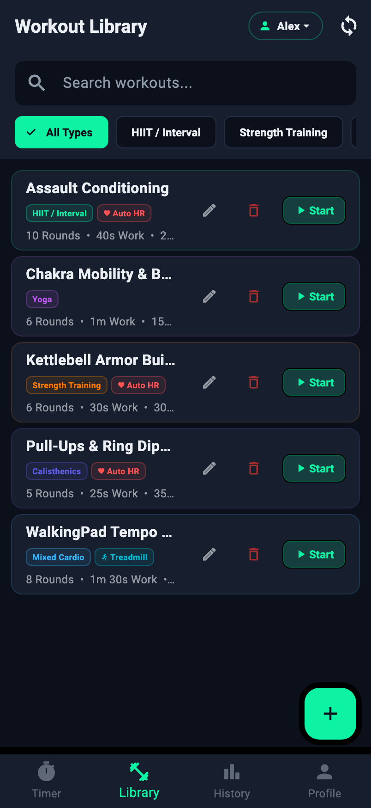</td>
  </tr>
  <tr>
    <td align="center"><b>Weekly Activity & History</b><br/>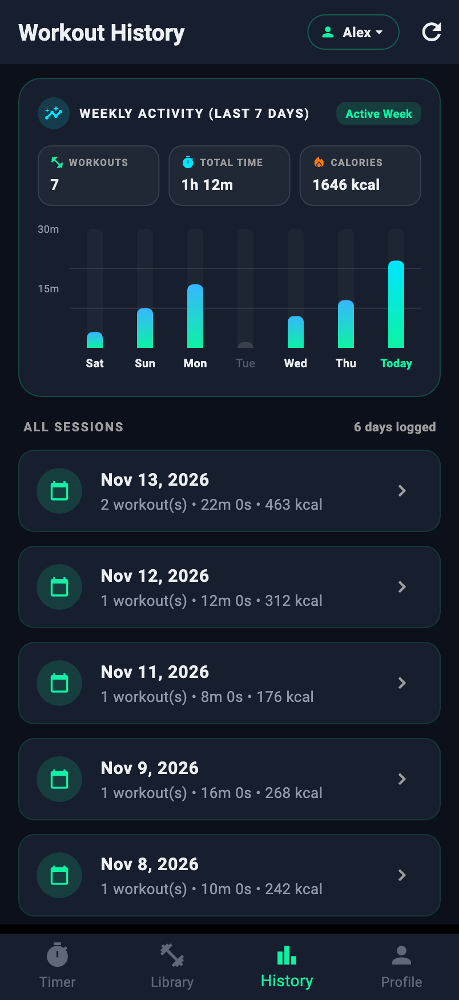</td>
    <td align="center"><b>Daily Session Cards</b><br/>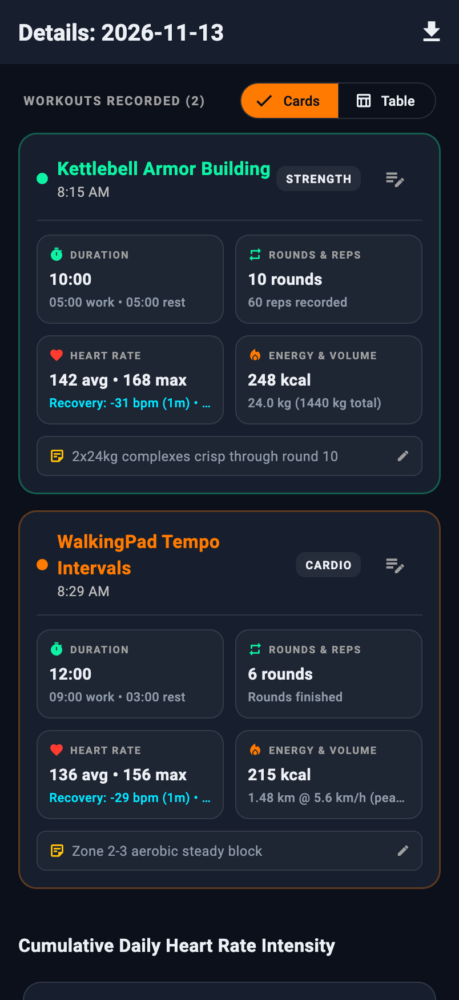</td>
    <td align="center"><b>Profile & Integrations</b><br/>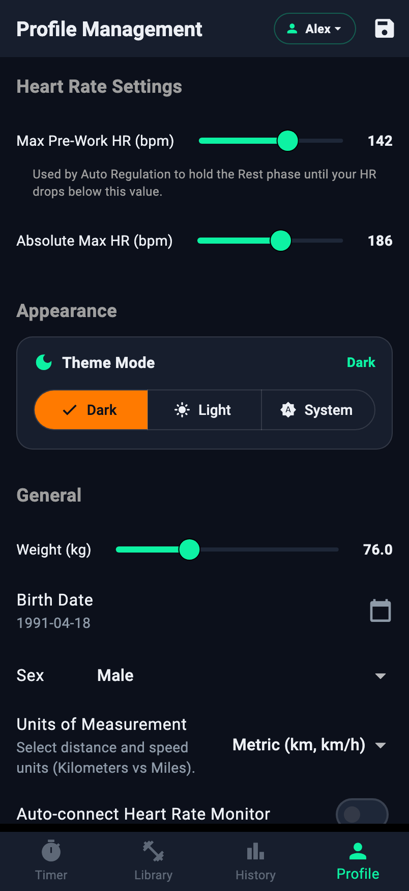</td>
  </tr>
</table>

---

## Core Capabilities

### 1. Adaptive Multi-Platform Interface
- **macOS Desktop Cockpit (`>= 900px`)**: Two-pane workspace (`flex: 4:7`) featuring an expanded radial countdown gauge (up to `450px`), inline transport bar, compact `NavigationRail`, persistent bottom-left profile capsule & BLE status, and right-hand telemetry cards with zero wasted space.
- **Desktop Keyboard Shortcuts**: `Space` (Start / Pause / Resume), `S` (Skip current phase), `Esc` (End workout), and `M` (Mute / Unmute Focus Music).
- **iPhone, Android & iPad Layouts**: `BottomNavigationBar` on portrait phones and compact tablets, full-screen landscape HUD mode when height `< 500px`, and adaptive modal dialogs/sheets (`ResponsiveUtils`).
- **Per-Profile Theme Engine**: Instant switching between **OLED Dark**, **Light**, and **System** appearance modes persisted per profile (`ThemeService`).

### 2. Precision Interval Engine & Smart Auto-Regulation
- **Full State Machine (`WorkoutEngine`)**: Clean transitions across `IDLE`, `10s PREP`, `WORK`, `REST`, `PAUSED`, and `FINISHED`, plus **Open-Ended Continuous Mode** for EMOM/AMRAP sessions without fixed round limits.
- **Heart Rate Auto-Regulation (`HOLDING...`)**: Optionally holds transitions from `REST` into the next `WORK` interval until live heart rate recovers below the athlete's configured `Max Pre-Work HR` threshold.
- **Non-Linear Configuration Sheet**: Piecewise Work & Rest duration sliders paired with fine increment/decrement steppers, Strength weight/reps or Ruck load targets, per-workout notes/cues, and Smart Wakelock (`wakelock_plus`) during active sessions.

### 3. Integrated Workout Audio & Focus Music
- **Phase Cues**: Preloaded chime cues (`Glass.wav` for Work, `Hero.wav` for Rest, `Tick.wav` for 5-second countdown ticks).
- **Bundled Looping Focus Soundtracks (`assets/music/`)**:
  - **Focus (`120 BPM`)** — structured cognitive & conditioning pulse (`focus.m4a`)
  - **Strength (`100 BPM`)** — grounded tempo for heavy lifting & calisthenics (`strength.m4a`)
  - **Running (`160 BPM`)** — high-cadence drive for cardio & WalkingPad intervals (`running.m4a`)
  - **Meditation (`Unhurried 7-Chakra Suite`)** — ambient pad with rosewood xylophone phrases (`meditation.m4a`)
  - **Auto Resolution**: Automatically selects the track from the workout's `ActivityType` (Cardio/Treadmill -> Running, Strength/Functional Strength/Calisthenics -> Strength, Yoga -> Meditation, others -> Focus), with `Off` option.
- **Phase-Aware Dynamic Ducking & HRR Cooldown**: Scales volume smoothly by workout phase (`PREP` `0.65x`, `WORK` `1.00x`, `REST` `0.45x`, `PAUSED` fade-out), micro-ducks briefly for interval chimes, and crossfades automatically into **Meditation** (`0.75x`) during post-workout Heart Rate Recovery tracking.
- **Live Audio Strip**: Compact mode selector, volume slider, and mute toggle synced per template (`music_mode`) and per profile (`music_volume`, `music_muted`).

### 4. Live Telemetry Dashboard & HR Intelligence
- **Interval Roadmap (`IntervalRoadmapCard`)**: Live phase badge & countdown paired with segmented progress pills (for `<= 12` rounds), compact round wrap chips (`13..24` rounds), or linear summary stats (`> 24` / continuous mode).
- **5-Zone Heart Rate Spectrum (`HeartRateZoneSpectrum`)**: Live distribution percentages across `Z1` Recovery, `Z2` Aerobic, `Z3` Tempo, `Z4` Threshold, and `Z5` Anaerobic zones alongside a custom-painted real-time `LIVE HR TREND` waveform.
- **4-Column Telemetry KPIs**: Peak / Avg HR + live zone indicator, Work / Rest Split + Auto-Reg target, biometric Calorie burn, and Strength Volume/Tonnage (`reps * weight`) or Ruck weight + `UP NEXT` banner.
- **Post-Workout Heart Rate Recovery (`HrrService`)**: Background 2-minute cooldown tracker logging `1Hz` recovery samples (`is_recovery = 1`) and saving **1-min (`hrr_1min`)** and **2-min (`hrr_2min`)** BPM drops from peak HR.

### 5. Workout Library & Activity Templates
- **9 Activity Types**: `HIIT / Interval`, `Strength Training`, `Functional Strength`, `Core Training`, `Mixed Cardio`, `Yoga`, `Pilates`, `Calisthenics`, and `Other`.
- **Search, Filter & 1-Tap Launch**: Instant text search, category filter chips, badges for `Auto HR` and `Treadmill`, full CRUD template editor, and cloud sync.

### 6. Hardware, Wearable & Health Integrations
- **BLE Heart Rate Monitors (`AppBluetoothService`)**: Connects to standard Bluetooth Heart Rate (`0x180D`) chest straps and sensors (e.g., Polar H10) with optional auto-connect on startup.
- **Kingsmith WalkingPad Treadmills (`TreadmillBluetoothService`)**: Custom BLE GATT protocol (`FE00`/`FE01`/`FE02` with checksum verification) supporting automatic speed changes across 3-2-1 prep spin-up, work/rest speed targets, pause/end safety stop, live distance/pace telemetry, and 3 customizable speed presets (`km/h` or `mph`).
- **Apple Watch (`watchOS`) & Apple Health (`HealthKit`)**: Native `WatchApp Watch App` (`HKWorkoutSession` -> `WCSession` bridged via `com.chronoPulse.active/watch_hr`) streams Watch HR to iPhone; Health integration (`HealthService`) reads biometric age/weight/sex and writes completed workouts, active calories, and distance to Apple Health.

### 7. History, Charts, Inline Editing & CSV Export
- **Weekly Activity Dashboard (`HistoryScreen`)**: 7-day rolling KPIs (Workouts, Total Time, Calories) with an interactive `fl_chart` daily duration bar chart and chronological session log.
- **Daily Drill-Down (`DetailsScreen`)**: Toggle cleanly between **Cards** and **Data Table** views (`SegmentedButton`), inspect cumulative daily `fl_chart` HR curves color-coded by activity across Z1–Z5 zone threshold lines plus cyan HRR cooldown tails, edit **Reps Completed** (automatically recalculating tonnage) and **Session Notes** inline, and export full **22-column CSV** reports via native file save picker.

### 8. Offline-First Persistence & Cloud Sync
- **SQLite Schema v21 (`DatabaseHelper`)**: Uses `sqflite` on iOS/Android and `sqflite_common_ffi` on macOS across `profiles`, `workout_templates`, `workouts`, and `heart_rate_logs` with automated incremental schema migrations.
- **Multi-Profile Switching & Firestore Sync (`SyncService`)**: Supports independent profiles (custom HR thresholds, body weight, units, theme, music prefs, and treadmill presets) synchronized bidirectionally with Firebase Cloud Firestore via anonymous authentication.

---

## Development & Verification

For local build configuration, BLE/watchOS protocol notes, and platform setup instructions, see [`developer.md`](developer.md).

```bash
# Static analysis
flutter analyze

# Unit & widget test suite (SQLite FFI, WorkoutEngine, CalorieCalculator, FormatUtils, ResponsiveUtils, Theme)
flutter test
```
